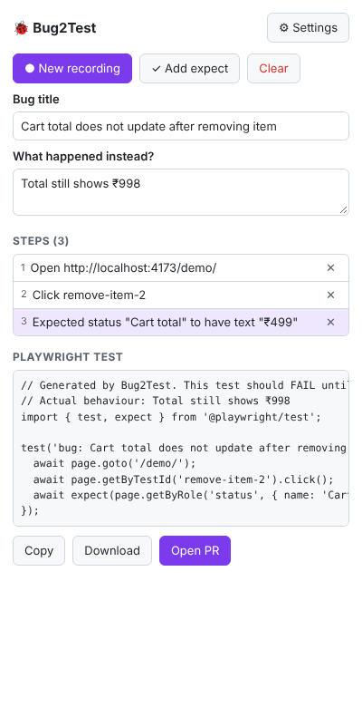
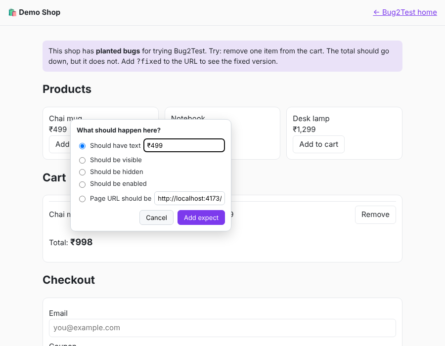

# Bug2Test

[](https://github.com/rahulcs754/bug2test/actions/workflows/ci.yml)

**Turn a bug report into a failing Playwright test.**

Bug2Test is a Chrome extension for testers. Record the bug in the browser, click on what is broken, and Bug2Test opens a pull request with a Playwright test that **fails today** and **passes once the bug is fixed**.

🌐 Website + live demo shop: **https://rahulcs754.github.io/bug2test/**

<p>
  
  
</p>

## Why use it

| Problem today | With Bug2Test |
|---|---|
| Dev says "can't reproduce" | The test **is** the reproduction. Run one command, see the bug. |
| Fixed bugs come back | Every bug ends with a regression test in the repo. |
| Testers can't write Playwright | Testers click; Bug2Test writes the code and picks good selectors. |
| Bug tickets miss details | PR lists steps, expected vs actual, console errors and failed requests. |

## How it works

1. Open the page with the bug and click **Start recording**.
2. Repeat the bug: click, type, select, press Enter. Each action becomes a step.
3. Click **Add expect**, click the broken element, and say what it **should** be (text, visible, hidden, enabled, or URL).
4. Click **Open PR**. Bug2Test adds `tests/bugs/<bug-title>.spec.ts` on a new branch and opens a PR.

Example output:

```ts
// Generated by Bug2Test. This test should FAIL until the bug is fixed.
// Actual behaviour: Total still shows ₹998
import { test, expect } from '@playwright/test';

test('bug: Cart total does not update after removing item', async ({ page }) => {
  await page.goto('/demo/');
  await page.getByTestId('remove-item-2').click();
  await expect(page.getByRole('status', { name: 'Cart total', exact: true })).toHaveText('₹499');
});
```

## Install (step by step)

1. **Get the extension**
   - Download `bug2test.zip` from [Releases](https://github.com/rahulcs754/bug2test/releases) and unzip it, **or**
   - Build it: `git clone https://github.com/rahulcs754/bug2test && cd bug2test && npm ci && npm run build` (output in `dist/`).
2. Open `chrome://extensions` and turn on **Developer mode** (top right).
3. Click **Load unpacked** and pick the unzipped folder (or `dist/`).
4. Pin Bug2Test in the toolbar (puzzle icon → pin).
5. Click the Bug2Test icon → **Settings**, and fill in:
   - **Repo owner / name**: where test PRs go, e.g. `acme` / `shop`
   - **GitHub token**: create a [fine-grained token](https://github.com/settings/personal-access-tokens/new) for that one repo with **Contents: Read and write** and **Pull requests: Read and write**
   - **App base URL**: same as `baseURL` in your `playwright.config`, e.g. `http://localhost:3000`
   - **Test folder**: default `tests/bugs`

## Use it (first bug in 1 minute)

1. Open the [demo shop](https://rahulcs754.github.io/bug2test/demo/). It has planted bugs.
2. Click the Bug2Test icon → **Start recording**. Allow access to the site when Chrome asks.
3. Click **Remove** on the Notebook. The total stays ₹998 (that's the bug).
4. Open the popup → **Add expect** → click the total → type `₹499` → **Add expect**.
5. Open the popup again → give the bug a title → **Stop**.
6. Click **Open PR**, or **Copy** / **Download** the test if you just want the file.

In your app repo, the dev then runs:

```bash
npx playwright test tests/bugs/<file>.spec.ts   # fails now
# fix the bug...
npx playwright test tests/bugs/<file>.spec.ts   # passes
```

## Tips for good tests

- Add `data-testid` to important elements. Bug2Test uses it first.
- Selector order: `data-testid` → role + name → label → placeholder → text → CSS. CSS selectors get a `// TODO: fragile selector` comment.
- Password, OTP, card and similar fields are **never recorded**. They become env vars like `process.env.B2T_PASSWORD`. Add `data-bug2test-sensitive` to any other input to hide it too.
- Logged-in pages: use Playwright [`storageState`](https://playwright.dev/docs/auth) in your config; Bug2Test does not record secrets.

## Privacy and permissions

- Asks for access only to the site you record (at the moment you click Start).
- Talks only to `api.github.com`. Your token stays in `chrome.storage.local` in your browser.
- Network capture keeps only method, URL (without query string) and status. Never bodies.

## Develop

```bash
npm ci
npm run dev        # build + watch into dist/, then "Load unpacked"
npm test           # unit tests (vitest): selectors, generator, GitHub client
npm run build      # typecheck + build dist/
npm run test:e2e   # loads the real extension in Chromium, records a bug on the demo shop,
                   # and checks the generated test fails on the bug and passes on the fix
```

Project layout:

```
src/core/        pure logic: selectors, steps, spec generator, GitHub PR client (unit tested)
src/content/     content script (recorder + Expect picker) and page script (console/network)
src/background/  service worker: recording state, site permission, opens the PR
src/popup/       React popup
src/options/     React settings page
site/            GitHub Pages: landing page + demo shop with planted bugs
```

Plan and research: [docs/MVP-PLAN.md](docs/MVP-PLAN.md), [docs/RESEARCH.md](docs/RESEARCH.md).

## Roadmap

- Jira / Linear: link the PR to the ticket
- Mock recorded network responses
- GitHub Action that runs `tests/bugs/` and comments when a bug is fixed
- Chrome Web Store listing

## License

MIT
